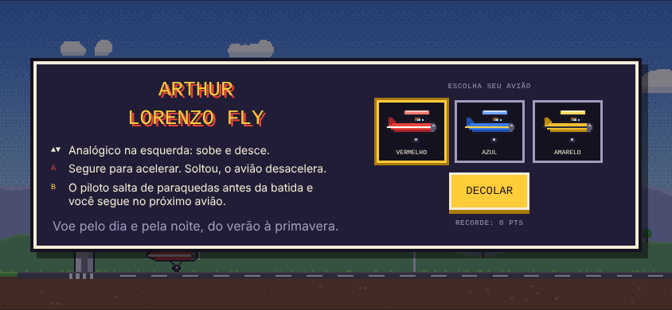

# Arthur Lorenzo Fly

Jogo 2D em pixel art para celular, jogado deitado. Um avião de asa parasol decola da pista e desvia de pássaros, balões, montanhas e cavernas. O cenário passa por dia e noite e pelas quatro estações.

## Jogar

| Onde | Como |
|---|---|
| **Qualquer celular (Android ou iPhone)** | Abra **https://ac-costa-games.github.io/arthur-lorenzo-fly/** no navegador. Para ter um ícone de app, use "Adicionar à tela inicial" (Chrome: menu ⋮; iPhone/Safari: botão Compartilhar). |
| **App Android (APK)** | No celular, abra **https://github.com/AC-Costa-games/arthur-lorenzo-fly/releases/latest/download/arthur-lorenzo-fly.apk**, baixe e instale. Se o Android pedir, autorize "instalar apps desconhecidos". |

## O que tem neste repositório

| Caminho | Conteúdo |
|---|---|
| `index.html` | O jogo inteiro em um único arquivo (HTML + CSS + JavaScript). É também a página do site. |
| `android/` | Projeto Android que empacota o jogo como app (tela cheia, deitado, com ícone). |
| `.github/workflows/gerar-apk.yml` | Automação que gera o APK no GitHub e publica em **Releases**. |
| `imagens/sprites/` | Todos os desenhos do jogo em pixel art, no tamanho original. |
| `imagens/sprites-grandes/` | Os mesmos desenhos ampliados 8 vezes, para ver ou editar. |
| `imagens/avioes-cartoon/` | Os três aviões em estilo cartoon (PNG e SVG), primeira versão dos desenhos. |
| `imagens/icone/` | Ícone do app. |
| `imagens/capturas/` | Fotos de tela do jogo. |

O jogo não carrega nenhum arquivo de imagem. Todos os desenhos são gerados pelo próprio código (listas de "pixels" dentro do `index.html`). As imagens da pasta `imagens/` são cópias exportadas desses desenhos, para consulta e edição.

## Atualizar o jogo

1. Edite o `index.html` e envie para o GitHub.
2. O site atualiza sozinho em cerca de 1 minuto.
3. O APK novo é gerado em cerca de 3 minutos (aba **Actions**) e aparece em **Releases**. A automação copia o `index.html` para `android/app/src/main/assets/` antes de compilar.

## Controles e pontos

- **Analógico (esquerda):** sobe e desce. Na pista, empurre para cima para decolar.
- **A (vermelho):** segure para acelerar. Soltou, o avião desacelera; muito devagar, ele perde força para subir.
- **B (amarelo):** o piloto salta de paraquedas antes da batida. O avião sem piloto explode, e você segue no próximo avião. Cada partida tem 3 aviões.
- Bater sem saltar encerra a partida.
- **No computador:** setas ou W/S sobem e descem, Espaço ou J acelera, K ou B salta, P pausa.

**Pontos:** 1 por metro, 25 por estrela, 100 por piloto salvo e 150 por caverna atravessada. O recorde fica salvo no aparelho.

## Como o código está organizado (`index.html`)

1. **Estilo (CSS):** cores em variáveis no `:root`, HUD, analógico (`.stick`), botões A/B (`.gp`) e painéis (menu, fim de jogo, pausa, "gire o celular").
2. **Constantes no topo do script:** `GY` (linha do chão), `RUNWAY` (tamanho da pista), `LIFT_SPEED`, `SEASON_LEN` (700 m por estação), `DAY_LEN` (90 s por dia), `LIVES` (3 aviões).
3. **Sprites:**
   - `PLANE_OPS` e `PILOT_OPS` desenham o avião 30×20.
   - `PLANES` define as três cores (vermelho, azul, amarelo).
   - `BIRD`, `BAT`, `BALLOONS`, `STAR`, `SUN` e `MOON` são os outros desenhos.
   - Cada letra nas listas de pixels é uma cor da paleta.
4. **Céus e estações:**
   - `SKY_DAY`, `SKY_DUSK` e `SKY_NIGHT` são os degradês do céu.
   - `SEASONS` guarda as cores de grama, colinas, árvores e montanhas de cada estação.
5. **Som:** objeto `Snd`, com sons gerados na hora pelo Web Audio (motor, estrela, salto, explosão, estação).
6. **Obstáculos:**
   - `spawnAt` cria montanhas, pássaros, balões e estrelas.
   - `makeCave` cria cavernas, com `caveCenter`, `caveAt` e `caveSpike` para o túnel e as estalactites.
   - `collide` testa as batidas.
7. **Explosões e partículas:** `explode`, `feathers` e `sparkle`.
8. **Salto de paraquedas:** `eject`, `updateEject` e `respawn`.
9. **Lógica principal:** `update(dt)` cuida da física, velocidade, decolagem e colisões. `updateWeather` faz neve, folhas, pétalas e vaga-lumes.
10. **Desenho:** `draw()` desenha, em ordem, céu, sol/lua/estrelas, montanhas ao fundo, colinas com árvores, cenário, chão, cavernas e montanhas, obstáculos, avião, luz da noite e partículas.
11. **Interface e controles:**
    - `showBanner` mostra os avisos grandes e `showOver` a tela de fim.
    - O analógico e os botões usam multitoque com pointer events; o teclado também funciona.

## Ideias para as próximas versões

- Chefões ou chuva de meteoros em certas distâncias.
- Loja de aviões, desbloqueados com as estrelas.
- Combustível que precisa ser recolhido no caminho.
- Músicas de fundo diferentes para cada estação.
- Placar de recordes com o nome do jogador.
